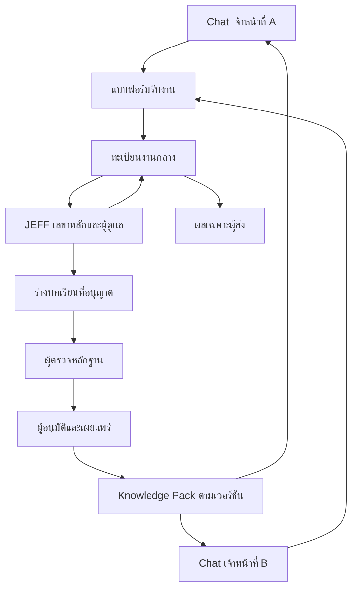

# JEFF V1.0 · คู่มือทดสอบและขยายผล

วันที่ 6 พฤศจิกายน 2569 · ใช้ข้อมูลสมมติในทุกขั้นของ Pilot

## ขอบเขตและรายงานตรวจระบบเดิม

| ฐานตรวจ | สิ่งที่พบ | สถานะ |
|---|---|---|
| main af5aa7e | HA V2 มีทะเบียน 16 บทบาท, workflow, survey CLI, templates และ fixtures | รันชุดทดสอบ HA ออฟไลน์แล้ว บทบาทอยู่ใน workflow ไม่มีหลักฐานว่าเรียก 16 โมเดล |
| PR #3 @ 345e504 | Merge แล้ว มีแบบออกแบบ dialogue / reviewed knowledge loop และ static portal | แบบออกแบบและ UI ต้นแบบ รุ่นเดิมไม่มีทะเบียนงานหรือระบบอนุมัติ |
| PR #4 @ 4e237255 | คู่มือทบทวนโครงร่างและชุดโจทย์จำลอง | เปิดอยู่ นำไฟล์ต้นฉบับมาใช้ใน branch นี้พร้อมชุดโจทย์ |
| PR #5 @ dc9e642 | คู่มือบทบาท PCT ออร์โธฯ และชุดโจทย์จำลอง | เปิดอยู่ นำไฟล์ต้นฉบับมาใช้ใน branch นี้พร้อมชุดโจทย์ |
| PR #6 @ a8a89d3 | AGENTS.md, chatgpt_project/, Skill Registry 29 ความสามารถ, jeff/router.py และ tests | เปิดอยู่ ใช้เป็นฐาน Draft PR; router จับคำและสร้างแผนเท่านั้น |
| research_team/ และ Research Team Master V4 | ไม่พบในต้นไม้ main และ PR #6 หรือรายการไฟล์ที่ PR #3–#5 เปลี่ยน | ยังไม่ยืนยันต้นฉบับ V4 และการติดตั้ง จึงใช้เฉพาะคู่มือ/กรอบที่ตรวจได้ |
| Skills นอก repo | ต้นฉบับคำสั่งหลัก JEFF Secretary และ Medical Record Review เปิดอ่านได้ใน Work รอบนี้ ส่วน nursing research/R&D/RCT มีหลักฐานตรวจจาก inventory ของ PR #6 | ยังไม่ทดสอบการเรียกใน Chat ของเจ้าหน้าที่หรืออ่านคู่มือย่อย/เอกสารอ้างอิงครบ |

การตรวจความเข้ากันได้อ้างอิง [Projects in ChatGPT](https://help.openai.com/en/articles/10169521-projects-in-chatgpt), [Projects and chats](https://learn.chatgpt.com/docs/projects), [Skill controls](https://learn.chatgpt.com/docs/enterprise/skills) และ [Connecting GitHub to ChatGPT](https://help.openai.com/en/articles/11145903-connecting-github-to-chatgpt) บัญชีและ workspace แต่ละแห่งต้องตรวจหน้าจริง เพราะ GitHub/App/Skill มีสิทธิ์แยกตามช่องทางและบัญชี ไฟล์ใน GitHub เป็นแหล่งต้นฉบับให้ Codex ใช้และให้ผู้ดูแลจัดชุดอัปโหลดเข้า Project การติดตั้ง Skill และการให้สิทธิ์ App ต้องทำในช่องทางที่รองรับ และใช้ Project Instructions กับไฟล์อัปโหลดเป็นเส้นทางหลักของ Pilot

## สถาปัตยกรรม



ลูกศรระหว่าง Chat กับระบบกลางหมายถึงคนคัดเฉพาะส่วนที่อนุญาตแล้วส่งเอง ผู้ดูแลอ่านทะเบียนและนำข้อมูลจำลองเข้าแชตเลขาหลัก ผู้ส่งเปิดผลตามสิทธิ์จากทะเบียน แดชบอร์ดอยู่กับระบบรับงาน รุ่นนี้ใช้ข้อมูลจำลองและแยกจาก TSH Smart Ward ทั้งหมด

## 1. ตั้ง ChatGPT Pilot หลังอนุมัติ

1. คุณหน่องสร้าง Project กลางไว้สำหรับตนเอง และสร้าง Project เจ้าหน้าที่ A แยก ตั้งชื่อด้วยรหัส Pilot เปิด Share แบบ Only those invited เชิญเฉพาะบัญชี A แบบ Chat access ตรวจให้ไม่มี group/workspace link และยืนยัน Project-only memory
2. Project กลางใช้ `PROJECT_INSTRUCTIONS_TH.md` ทั้งฉบับ ส่วน Project เจ้าหน้าที่ใช้เนื้อหากลางต่อด้วย `STAFF_ADDENDUM_TH.md` ตามวิธีในไฟล์ อัปโหลด `SKILL_REGISTRY_TH.md`, `ROUTING_RULES_TH.md`, `KNOWLEDGE_PACK_TH.md`, `KNOWLEDGE_SOURCE_MAP_TH.md`, `research-review.md` และ `pct-ortho.md` จาก revision เดียวกัน สำหรับแผนที่มีเพดานต่ำกว่านี้รวมไฟล์ความรู้เป็นชุดเดียวก่อนอัปโหลด
3. เปิด Chat ด้วยบัญชี A ทดสอบตามรายงานผล ผู้ร่วม Project เห็นแชตและไฟล์ใน Project เดียวกันรวมถึงคุณหน่อง ให้บอกเจ้าหน้าที่ก่อนเริ่ม Chat access จำกัดสิทธิ์ใน Project การใช้ Work ของบัญชีขึ้นกับการตั้งค่าบัญชีและ workspace แยกกัน
4. ใช้บัญชีจำลอง B เป็น negative control ลองเปิดลิงก์ของ A โดยไม่รับคำเชิญและไม่ใช้บัญชีเจ้าของ บันทึกวัน บัญชีรหัสจำลอง โหมด Chat และผล โดยไม่เก็บรหัสผ่านหรือสำเนาแชตจริง

## 2. รันแบบฟอร์มและทะเบียนงานจำลองบนเครื่องเดียว

ต้องใช้ Python 3.12 และอยู่ที่ราก repository
```sh
pilot_dir=$(mktemp -d)
python -m jeff.pilot "$pilot_dir/pilot.sqlite"
```

เปิด URL ที่โปรแกรมแสดงบนเครื่องเดียวกัน เก็บรหัสทดลองที่แสดงครั้งแรกไว้ชั่วคราวในที่ส่วนตัว รหัสไม่ควรอยู่ในแชต/PR ฐานใช้ SQLite เก็บ snapshot และประวัติต่อธุรกรรม เหมาะกับข้อมูลจำลองขนาดเล็กเท่านั้น

| ผู้ทำ | แบบฟอร์ม | ค่าเพื่อทดลอง |
|---|---|---|
| staff-a | submit | request_key `trial-001`, หัวเรื่องและสรุปสมมติ, category `rd` หรือ `rca`, priority `normal` หรือ `high`; จดเลข J- จากผล |
| admin | tasks / dashboard | ตรวจผู้ส่ง หน่วยงาน ประเภท ความสำคัญ เส้นทางที่ router เสนอและงานค้าง |
| admin | assign → finish | ใส่เลข J- ผู้รับ `admin` แล้วใส่ feedback ที่ตรวจและอนุญาตแล้ว |
| staff-a / staff-b | tasks | A เห็นสถานะและผลของตน B เห็นเฉพาะงานของ B แม้รู้เลขของ A |
| ทุกบทบาท | issue | แจ้งปัญหาจำลองหรือข้อเสนอให้ผู้ดูแลดูใน dashboard |

ส่งซ้ำด้วย request_key และข้อมูลเดิมจะได้เลขเดิม ถ้าแก้รายละเอียดให้ใช้คีย์ใหม่ตามที่ตั้งใจ งานใน Pilot มอบหมายให้เลขาหลักได้คนเดียวและติดตามด้วยหน้า tasks การแจ้งผ่านอีเมลหรือแชตยังไม่มี

## 3. ทดสอบ Knowledge Pack และย้อนรุ่น

- staff-a ส่ง `propose` ใส่บทเรียนที่อนุญาตให้ส่ง ขอบเขต แหล่ง ฉบับ และวันที่ ISO YYYY-MM-DD จดเลข K-
- reviewer เปิด `review_queue` แล้วใช้ `review` ยืนยันจากหลักฐานและบันทึกเหตุผล จากนั้น admin ใช้ `approve` ผล `yes` หรือ `no` ผู้เสนอ ผู้ตรวจ และผู้อนุมัติต้องแยกกัน ใน Pilot ใช้บัญชีเจ้าหน้าที่เสนอเพื่อให้ admin คนเดียวอนุมัติได้ หากปฏิเสธให้ส่งร่างใหม่ที่อ้างรหัสเดิมในขอบเขตเพื่อคงประวัติ
- admin ใช้ `release` ระบุเวอร์ชัน x.y.z และรายการ K- ที่อนุมัติแล้วทั้งหมดของรุ่นนั้นคั่นด้วยจุลภาค `pack` แสดง snapshot รุ่นปัจจุบันสำหรับให้ผู้ดูแลคัดเข้า Project ทดสอบทีละแห่งและจดรุ่น วันที่ ผู้ติดตั้ง และผลตรวจ บันทึกผลการใช้ผ่าน `issue`
- ใช้ `rollback` เลือกรุ่นก่อนและกรอกเหตุผล แล้วเปลี่ยนไฟล์ใน Project กลับด้วย การย้อนในฐานไม่เปลี่ยนไฟล์ ChatGPT อัตโนมัติ เก็บ snapshot และประวัติการเผยแพร่ทั้งสองรุ่น ห้ามใช้ร่างหรือเอกสารที่ยังไม่ผ่านตรวจเป็นความรู้ร่วม

## 4. ทางเลือก Google สำหรับ Pilot แบบแยกเครื่อง

หลังอนุมัติ ให้สร้าง Google Form แยกใน Drive ที่ได้รับอนุญาต เปิดรับเฉพาะผู้ทดสอบและเก็บอีเมลแบบ Verified ปิดการแชร์ผลรวมกับผู้ตอบ เชื่อม Response Sheet เฉพาะผู้ดูแล ตรวจอีเมลกับ allowlist เพื่อหาผู้ส่งและหน่วยงาน เก็บหัวเรื่อง สรุป เป้าหมาย ประเภท ความสำคัญ และการยืนยันข้อมูลสมมติ แยกฟอร์มรับบทเรียนจากงาน ปฏิบัติการตรวจ/อนุมัติอยู่ในทะเบียนกลางโดยคนที่ได้รับสิทธิ์เท่านั้น

ระยะแรกผู้ดูแลออกเลข J- และอัปเดตสถานะจากทะเบียนกลาง แล้วคัดเฉพาะข้อมูลของผู้ส่งไปยังแฟ้มตอบกลับรายคนที่จำกัดผู้เปิดด้วยบัญชี Google ทดสอบด้วย B ว่าเปิดทั้งทะเบียนกลางและแฟ้มของ A ไม่ได้ ห้ามใช้ Filter view เป็นตัวแยกสิทธิ์ ขณะนี้แบบฟอร์มและทะเบียน Google เป็นแผนติดตั้ง ต้นแบบที่ทดสอบแล้วใช้ SQLite ในเครื่อง

เมื่อปริมาณเพิ่มค่อยประเมิน Apps Script installable form-submit trigger ใช้ response ID เพื่อกันบันทึกซ้ำ แยกทะเบียนงานและการส่งผล และติดตามงานที่บันทึกแล้วแต่ส่งผลไม่สำเร็จ ก่อนเปิดงานจริงต้องทดสอบบัญชีที่ trigger ทำงานภายใต้สิทธิ์ การขัดข้อง และ rollback ด้วยบัญชีทดสอบ [Google Forms verified email](https://support.google.com/docs/answer/139706) · [Apps Script event objects](https://developers.google.com/apps-script/guides/triggers/events)

## 5. แผนขยาย

| ระยะ | วิธีขยาย | เงื่อนไขผ่าน |
|---|---|---|
| 1 คน | A ใช้ Chat, admin ดูแล, reviewer ตรวจบทเรียน, B ใช้เฉพาะทดสอบปฏิเสธการเข้าถึง | ครบ 8 กรณีในรายงาน รับงานและคืนผลจริงด้วยข้อมูลสมมติ บัญชี B เข้า A ไม่ได้ |
| 10 คน | สร้าง Project แยกตามแม่แบบ ให้ผู้ดูแลเก็บทะเบียนสิทธิ์และเวอร์ชัน กระจายรุ่นเป็นชุดย่อยและมีทางย้อน | ตรวจคำเชิญทุกคน ตรวจความตรงของเวอร์ชัน และจับเวลาการคืนงานตามเกณฑ์ที่คุณหน่องตกลง |
| 20 คน | คง 1 Project ต่อคน เพิ่มคิวตรวจทาน ทบทวนสิทธิ์และรอบเผยแพร่ พิจารณา Apps Script ที่ได้รับอนุมัติสำหรับงานซ้ำ | ทดสอบกรณีบัญชีออกจากทีม การส่งซ้ำ งานค้าง การคืนรุ่น และตรวจประวัติก่อนรับข้อมูลจริง |

การเชื่อมบัญชี เปลี่ยนสิทธิ์ ส่งข้อมูลจริง เปิดใช้งานนอกเครื่อง เผยแพร่ และ Merge เข้าสู่ main ต้องรอเจ้าของอนุมัติ ใช้รหัสจำลองที่สร้างสำหรับ Pilot แยกจากบัญชีและฐานงานโรงพยาบาล
